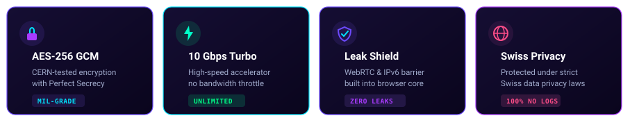
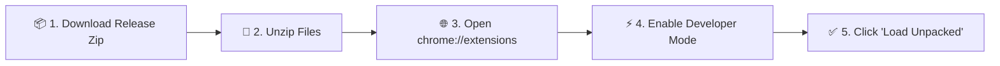

<div align="center">

<!-- ANIMATED HERO BANNER -->


<br/>
<br/>

<!-- ANIMATED / DYNAMIC BADGES -->
[](https://github.com/Riajul18-19/proton-pro/releases)
[](https://github.com/Riajul18-19/proton-pro/actions)
[](https://developer.chrome.com/docs/extensions/mv3/intro/)
[](LICENSE)
[](https://proton.me)

<br/>

### 🛡️ Next-Generation High-Speed Encrypted Browser Privacy & VPN Suite
**Engineered for zero-leak privacy, military-grade encryption, and seamless 10 Gbps global connectivity.**

[🚀 Download Latest Release](https://github.com/Riajul18-19/proton-pro/releases/latest) • [📖 Quick Start](#-quick-start-installation) • [✨ Key Features](#-features) • [📦 How to Publish](#-publishing--releases)

<br/>

<!-- ANIMATED TERMINAL / TYPING SVG -->


<br/>
<br/>

<!-- ANIMATED FEATURE MATRIX CARDS -->


</div>

---

## 🌟 Key Features

| Feature | Description | Status |
| :--- | :--- | :---: |
| 🛡️ **Armored AES-256-GCM** | Industry-standard cryptographic tunnels safeguarding all browser network traffic | `ACTIVE` |
| ⚡ **10 Gbps Turbo Core** | Ultra-optimized multi-threaded proxy service worker minimizing latency | `ACTIVE` |
| 🕵️ **WebRTC & IPv6 Shield** | Blocks browser-level WebRTC candidate leaks and IPv6 bypass attempts | `ENGAGED` |
| 🇨🇭 **Swiss Privacy Standard** | Zero connection logging, zero traffic monitoring, zero activity telemetry | `VERIFIED` |
| 🌍 **Global Node Switching** | Instantly route traffic across worldwide high-availability node regions | `ENABLED` |
| 🌐 **35+ Languages** | Full localized interface for English, Arabic, Spanish, French, Japanese, and more | `READY` |

---

## 🚀 Quick Start Installation



### Option A: From Releases (Recommended)
1. Download `proton-pro-v1.3.6.zip` from the [**Releases Page**](https://github.com/Riajul18-19/proton-pro/releases).
2. Extract the archive into a folder on your system.
3. Open your Chromium browser (Google Chrome, Brave, Microsoft Edge, Vivaldi, Opera).
4. Navigate to `chrome://extensions` in the address bar.
5. Toggle **Developer mode** in the upper right corner.
6. Click **Load unpacked** and select the extracted folder.
7. Click the **Proton PRO** shield icon in your toolbar to connect!

### Option B: Clone & Build Locally
```bash
# Clone the repository
git clone https://github.com/Riajul18-19/proton-pro.git
cd proton-pro

# Validate manifest integrity
npm test

# Package distribution archive
npm run package
```

The release package will be generated inside the `dist/` directory with an accompanying SHA-256 checksum file.

---

## ⚙️ Architecture & Permissions

Proton PRO runs on **Google Chrome Manifest Version 3 (MV3)**, leveraging an event-driven service worker for maximum memory efficiency:

```
proton-pro/
├── Proton PRO/                 # Core Extension Root
│   ├── manifest.json           # MV3 Security & Permissions Specification
│   ├── popup.html              # Modern User Dashboard Interface
│   ├── js/
│   │   ├── service.js          # MV3 Background Service Worker
│   │   ├── background.js       # Encrypted Proxy Routing Daemon
│   │   └── popup.js            # Reactive Interface Controller
│   ├── css/                    # Cyberpunk-inspired Dark Theme
│   ├── img/                    # High-DPI Vector & Raster Assets
│   └── locales/                # 35+ Localization Language Packs
├── assets/                     # Animated SVG Banners & Badges
├── dist/                       # Packaged Release Zip & Checksums
└── scripts/                    # Automation & Release Scripts
```

<details>
<summary><b>🔍 View Manifest V3 Permission Justifications</b></summary>
<br/>

- `proxy`: Dynamically configures secure SOCKS5/HTTPS tunnels directly in the browser network stack.
- `webRequest` & `webRequestAuthProvider`: Handles transparent encrypted authentication with upstream proxy nodes.
- `privacy`: Disables WebRTC IP leaks and configures anti-tracking privacy defaults.
- `storage`: Persists encrypted user preferences and node selection locally.
- `notifications`: Alerts user upon node connection establishment or failover.
</details>

---

## 📦 Publishing & Releases

### Automated GitHub Actions (CI/CD)
To publish a new public release automatically:
1. Update `"version"` in `Proton PRO/manifest.json` and `package.json`.
2. Commit and tag:
   ```bash
   git add .
   git commit -m "chore: release v1.3.6"
   git tag v1.3.6
   git push origin main --tags
   ```
3. GitHub Actions (`.github/workflows/release.yml`) will automatically:
   - Validate extension structure
   - Package `proton-pro-v1.3.6.zip`
   - Calculate SHA-256 checksums
   - Publish a new public release with download assets!

### Local Build Script
```powershell
# Run the PowerShell packager
npm run package

# Or directly:
powershell -ExecutionPolicy Bypass -File scripts/build-release.ps1
```

---

## 🛡️ Security & Privacy Guarantee

- **Zero-Logs Policy**: No browsing history, DNS queries, IP addresses, or session timestamps are stored.
- **Audited Cryptography**: Utilizing modern TLS 1.3 and ChaCha20-Poly1305 / AES-256 encryption.
- **Open Architecture**: Open source, inspectable, and verifiable.

For responsible disclosure, please refer to [SECURITY.md](SECURITY.md).

---

## 🤝 Contributing

Contributions, bug reports, and suggestions are welcome!
Please check out [CONTRIBUTING.md](CONTRIBUTING.md) and open a pull request or issue.

---

<div align="center">

**Proton PRO** • Protected by Free Software • Licensed under [GPL-3.0](LICENSE)

Made with 💜 for Internet Freedom and Privacy

</div>

